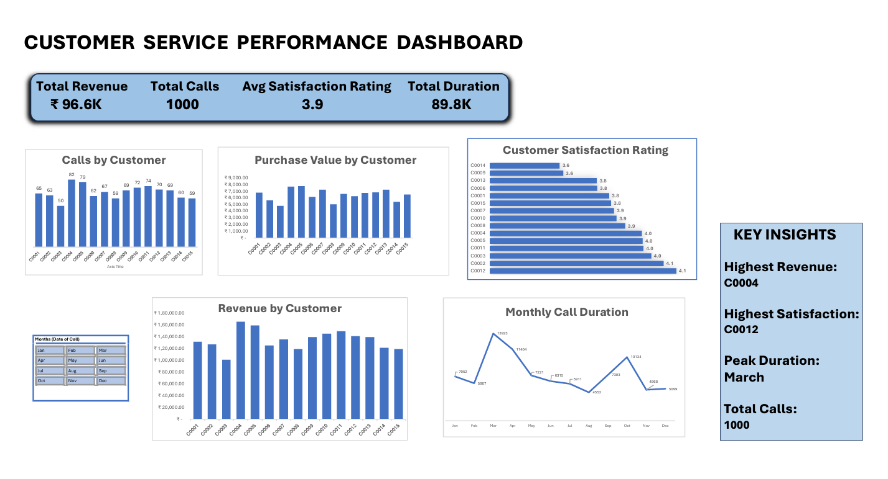

# Customer Service Performance Dashboard | Excel

## Project Overview
This project analyzes customer service performance using Microsoft Excel. The dashboard summarizes revenue, customer calls, satisfaction ratings, and monthly call duration to support data-driven decisions.

## Tools Used
- Microsoft Excel
- PivotTables and slicers
- Charts and data visualization
- Dashboard design and KPI reporting

## Dashboard Preview

## Key Performance Indicators
- Total Revenue: ₹96.6K
- Total Calls: 1,000
- Average Satisfaction Rating: 3.9
- Total Duration: 89.8K (as displayed in the dashboard)

## Dashboard Features
- Calls by customer
- Purchase value by customer
- Customer satisfaction ratings
- Revenue by customer
- Monthly call duration trends
- Month filter for interactive exploration

## Key Insights
- C0004 has the highest revenue according to the dashboard.
- C0012 has the highest customer satisfaction rating.
- March is the peak month for call duration.
- The dashboard summarizes 1,000 customer calls.

## Project Files
- `Customer_service_dashboard_excel.xlsx` — Excel workbook containing the dashboard.
- `excel-dashboard.png` — Dashboard preview image.

## How to Use
Download the Excel workbook and open it in Microsoft Excel to explore the dashboard and available filters.

## Author
Sathvika Jabisetty
